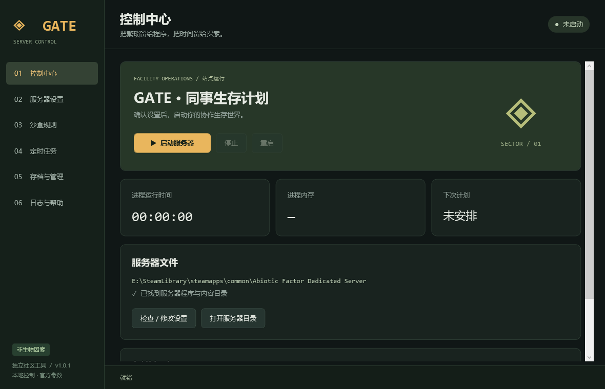

# GATE Control · 非生物因素一键开服器

**Abiotic Factor One-click Server · v1.0.1 · Windows 10 / 11 x64 · 中文界面**

GATE Control 是面向《非生物因素》（Abiotic Factor）专用服务器的 Windows 桌面管理工具。通过六个中文页面集中管理启动参数、48 项沙盒规则、服务器进程、维护倒计时、世界存档和管理员白名单，减少手动编辑启动脚本与 INI 文件的操作。

本仓库提供可直接运行的程序、完整 C# / WPF 源码、原始发布压缩包及随包测试记录。工具不包含游戏服务器资源，也不会自动安装服务器或配置公网连接。

## 下载与预览

- **[下载 GATE-Control-v1.0.1.zip](https://github.com/SilverXIV-14/Abiotic-Factor-One-click-Server/raw/refs/heads/main/downloads/GATE-Control-v1.0.1.zip)**：原始完整发布包，包含 EXE、源码、说明与测试记录。
- [下载 GateControl.exe](https://github.com/SilverXIV-14/Abiotic-Factor-One-click-Server/raw/refs/heads/main/GateControl.exe)
- [原始使用说明](使用说明.md) · [1.0.1 修复与升级说明](修复说明-1.0.1.md) · [全部沙盒参数](docs/SANDBOX.md)



## 运行条件

| 项目 | 要求 |
| --- | --- |
| 操作系统 | Windows 10 / 11，64 位 |
| 程序运行时 | .NET Framework 4.8 |
| 服务器 | 已安装完整的 Abiotic Factor Dedicated Server |
| 文件权限 | 当前 Windows 用户能读写服务器配置、存档和本地偏好目录 |
| 额外环境 | 无需 Python、Node.js、.NET 7 或 NuGet 依赖 |

程序按当前用户权限运行，不默认申请管理员权限。实际启动的服务器程序为 `AbioticFactor\Binaries\Win64\AbioticFactorServer-Win64-Shipping.exe`，并检查 `AbioticFactor\Content\Paks` 是否存在。

## 快速开始

1. 下载并解压完整包或只下载`GateControl.exe`。
2. 在“服务器设置”中自动识别或手动选择专用服务器根目录，程序会检查自身目录、Steam 注册表及游戏库、固定磁盘上的常见 SteamLibrary 目录。
4. 如需调整玩法，进入“沙盒规则”，先“读取当前世界”，修改后“保存并应用规则”；也可勾选启动时应用规则。
5. 回到“控制中心”启动，等待显示“世界已加载”。
6. 维护前先在游戏内保存进度，再从工具正常停服。修改沙盒、白名单或处理存档时需处于停服状态。

**也可把 EXE 放在专用服务器根目录运行。** 游戏目录中的原有文件仍须保留。删除或移动开服器不会删除游戏存档和本地偏好。

## 六个功能页面

| 页面 | 功能与行为 |
| --- | --- |
| 控制中心 | 启动、正常停止、重启；显示 PID、世界、端口、运行时长、内存和加载状态 |
| 服务器设置 | 自动发现路径；设置房间、世界、人数、密码、IPv4 绑定、端口、局域网及平台限制；预览脱敏后的启动参数 |
| 沙盒规则 | 世界、敌人、玩家三组共 48 项规则；支持中文或键名搜索、读取当前世界、恢复默认、保存独立 INI |
| 定时任务 | 倒计时停服或重启；重启可循环；显示剩余时间和预计执行时间 |
| 存档与管理 | 列出世界、备份当前世界、导入单个世界文件夹、编辑 SteamID64 管理员白名单 |
| 日志与帮助 | 查看服务器日志末尾和工具事件、导出显示内容、打开本地配置目录、访问参数文档、手动强制结束进程 |

## 服务器设置详解

| 设置 | 默认值 / 校验 | 对应参数或说明 |
| --- | --- | --- |
| 房间名 | 不允许为空、双引号或控制字符 | `-SteamServerName`，用于房间显示 |
| 世界名 | `Cascade`；有效文件夹名，最长 100 字符 | `-WorldSaveName`，更改后切换世界 |
| 玩家上限 | 6；允许 1–24 | `-MaxServerPlayers`；原包说明建议不超过 6 人 |
| 游戏端口 | 7777 | `-PORT`，1–65535 |
| 查询端口 | 27015 | `-QUERYPORT`，1–65535，不能与游戏端口相同 |
| 房间 / 管理员密码 | 空 | `-ServerPassword` / `-AdminPassword` |
| 本地 IPv4 绑定 | 空，使用游戏默认 | `-MultiHome`；只能选择本机地址或 `0.0.0.0` ； 若使用虚拟网卡建立服务器，则需要填入虚拟网卡地址，如：10.0.0.1|
| 平台限制 | 不限制 | `-PlatformLimited`：PC、Playstation、Xbox；不代表已完成跨平台验证 |
| 局域网模式 | 关闭 | `-LANOnly` |
| 本地 IP 模式 | 关闭 | `-UseLocalIPs`，用于局域网排错，可能影响互联网加入 |
| 性能线程 | 开启 | `-useperfthreads` |
| 原生控制台 | 默认尝试隐藏 | 始终使用 `-log -newconsole`，用于日志和退出通道 |

启动前会尝试绑定两个 UDP 端口，检查端口是否可用；同时检查同一安装目录是否已有服务器进程。公网 IP 通常不是本机网卡地址，不应直接填入绑定 IP。公网连接涉及路由器、防火墙和运营商网络；本工具不会自动修改它们。原包说明另列出局域网发现端口 14001。

## 沙盒规则如何生效

程序从 `source/sandbox.tsv` 加载 48 项规则的键名、中文名称、默认值、类型和范围。布尔值、枚举和有上下界的数值会校验；`StructuralSupportLimit`、`BonusPerkPoints`、`BaseInventorySize` 仅按 32 位整数校验，不能将其理解为任意取值都适合游戏。

保存位置为：

```text
<服务器目录>/AbioticFactor/Saved/Config/WindowsServer/GateControl/<世界名哈希>.ini
```

哈希由世界名转小写后计算 SHA-256。启动时通过相对 `Saved` 目录的 `-SandboxIniPath` 加载。第一次保存会从原世界的 `SandboxSettings.ini` 继承未编辑配置；后续优先读取独立文件。写入时保留未知键和其他节，并为被替换文件创建备份。

**独立规则文件一旦存在，取消“启动时应用”也不会停用已保存规则。** 需要默认规则时，在界面恢复默认并保存。更换服务器路径或世界后，应重新读取当前世界，以免使用上一世界的界面设置。

完整默认值、范围及提示见 [48 项沙盒参数表](docs/SANDBOX.md)。

## 进程控制与定时维护

- 仅检测到 `Facility` 地图加载完成才显示“世界已加载”；`ServerEntry` 或进程存活都不作为成功开服的依据。
- 识别存档损坏日志后显示错误并取消计划；启动前会拦截空世界目录或只有沙盒配置的旧目录。
- 正常停止先通过辅助进程发送 Windows 控制台事件；无法使用时，尝试向属于目标 PID 的日志或控制台窗口发送 `WM_CLOSE`。辅助进程最多等待 5 秒，之后等待服务器退出最多 45 秒。
- 超时不会自动强杀，也不会继续启动第二个进程。手动强制结束位于“日志与帮助”，可能丢失未保存进度。
- 倒计时允许 **0.05–10080 分钟（3 秒至 7 天）**。只允许循环重启，不能循环停服；首次安排需等待世界正常加载。
- 计划只存在于开服器内存中。退出工具、手动停服、进程提前结束或检测到损坏都会取消计划；系统睡眠可能推迟执行。
- 退出工具时可选择停服后退出或保留服务器运行。下次打开会核对保存的 PID、进程启动时间和 EXE 路径，再尝试重新连接；不会恢复倒计时。

正常退出信号不等于游戏内强制存档。多人维护前请提前通知玩家，并在游戏内保存世界。程序没有自动崩溃拉起、Windows 服务安装或持久化计划任务功能。

## 存档备份、迁移与管理员

世界目录：

```text
<服务器目录>\AbioticFactor\Saved\SaveGames\Server\Worlds\<世界名>
```

**备份：** 停服后选择备份当前世界，生成包含世界文件夹的 ZIP。备份只覆盖该世界目录，不包含其他世界、服务器安装文件、独立沙盒规则或管理员配置；完整迁移时应另外保留相应配置。

**导入：** 选择含 `.sav` 文件的单个世界文件夹，不要选择整个 `Worlds`。工具复制文件并保留源目录；同名目标存在时拒绝覆盖。导入完成后设为当前世界。Steam 个人世界通常位于 `%LocalAppData%\AbioticFactor\Saved\SaveGames\<SteamID>\Worlds`。

**恢复 ZIP：** 先停服，将备份解压到临时位置，再导入其中的单个世界文件夹。同名冲突时，先为待导入文件夹换一个世界名。导入和备份会拒绝目录联接或符号链接。

**管理员：** 先读取白名单，每行填写一个 17 位数字 SteamID64，再保存到 `Admin.ini` 的 `[Moderators]` 节。写入会去重，保留其他配置及封禁列表。踢人、封禁在游戏内管理员界面操作；本工具未实现外部玩家列表、RCON 踢人、广播或远程保存命令。

## 数据位置与口令处理

| 数据 | 位置 |
| --- | --- |
| 偏好及加密口令 | `%LocalAppData%\GateControl\profile.xml` |
| 已启动进程记录 | `%LocalAppData%\GateControl\active.xml` |
| 世界 ZIP 备份 | `%LocalAppData%\GateControl\Backups` |
| 独立沙盒 INI | `<服务器目录>\AbioticFactor\Saved\Config\WindowsServer\GateControl\` |
| 管理员配置 | `<服务器目录>\AbioticFactor\Saved\SaveGames\Server\Admin.ini` |
| 游戏日志 | `<服务器目录>\AbioticFactor\Saved\Logs\AbioticFactor.log` |
| 修改前的 INI 备份 | 对应 INI 同目录内带时间戳的 `.bak` 文件 |

口令使用 Windows 当前用户 DPAPI 加密，因此换 Windows 用户或迁移到其他电脑后可能无法解密，需要重新设置。服务器启动时仍通过命令行接收口令，具有相应本机权限的人可能读取进程参数。工具参数预览和显示日志会遮盖口令，但原生游戏日志仍可能包含 IP、玩家标识等信息。

工具源码未包含遥测上传逻辑；游戏服务器自身的联网行为由游戏决定。程序未进行商业代码签名。

## v1.0.1 修复内容

v1.0 曾在新世界生成前创建世界目录并写入沙盒 INI，导致游戏把只有配置文件的目录识别为不完整存档；旧测试又把 `ServerEntry` 加载误认为成功。

v1.0.1 将规则移到独立配置目录，使用 `SandboxIniPath` 加载，不再提前创建世界目录；加入旧空目录检查、损坏日志识别，并要求 `Facility` 加载成功。

如果旧版本创建的世界尚无游玩进度，可停服后换一个未使用过的世界名，重新读取并保存规则，再启动。已经有真实进度的损坏存档不能套用此方法，请先备份并调查。详见 [完整修复说明](修复说明-1.0.1.md)。

## 源码结构与构建

```text
.
├── GateControl.exe             # 原始 v1.0.1 程序
├── README.md                   # 仓库软件说明
├── SHA256.txt                  # 原始 EXE 校验值
├── 界面预览.png
├── 使用说明.md / 修复说明-1.0.1.md
├── downloads/                  # 未改动的原始 ZIP
├── docs/SANDBOX.md              # 从源码字段表生成的完整参数说明
├── source/
│   ├── App.cs                  # 界面交互、计时、备份导入、白名单
│   ├── Core.cs                 # 配置校验、INI、DPAPI、路径及进程控制
│   ├── MainWindow.xaml         # 六页 WPF 界面
│   ├── sandbox.tsv             # 48 项规则定义
│   ├── Tests.cs                # 自检及隔离服务器测试
│   ├── AssemblyInfo.cs         # 版本和目标框架
│   ├── app.manifest / app.ico
│   └── build.ps1               # 调用系统 C# 编译器
└── tests/                      # 原包历史验证记录
```

在 Windows PowerShell 中，从仓库根目录执行：

```powershell
powershell -NoProfile -File .\source\build.ps1
```

输出为 `build\GateControl.exe`。脚本使用 `C:\Windows\Microsoft.NET\Framework64\v4.0.30319\csc.exe`，目标 x64，引用系统 .NET / WPF 程序集，将 XAML、沙盒字段及图标嵌入程序。源码未使用 `.csproj` 或 NuGet 包。

可在自建临时目录运行核心检查：

```powershell
New-Item -ItemType Directory -Force .\work\qa | Out-Null
$report = Join-Path (Resolve-Path .\work\qa) 'self-test.txt'
Start-Process -FilePath .\build\GateControl.exe -ArgumentList ('--self-test "' + $report + '"') -Wait
Get-Content $report
```

其他诊断参数见 [源码说明](source/README.md)。`--integration` 会修改指定服务器副本并启动真实进程，只能用于可丢弃的隔离副本。不要指向生产服务器目录。

## 验证记录与适用边界

原始发布包附带的记录显示：

- [核心检查](tests/unit-v1.0.1.txt)：97 项通过，涵盖默认值、参数校验、密码加密与脱敏、INI 保留与备份、路径、倒计时及复制。
- [隔离集成测试](tests/integration-v1.0.1.txt)：中文新世界名连续两次进入 `Facility`，游戏确认难度为 2，无存档损坏标记。
- [日志摘录](tests/game-log-evidence.txt)：记录了沙盒值应用、地图加载与 ConsoleCtrl 退出请求。

**这些是随包历史记录，不是本次上传重新运行游戏测试的结果。** 集成记录中生成的 `.sav` 文件数为 0，且没有玩家加入，因此不能证明玩家进度保存、备份恢复后的游戏内状态、多人、公网或跨平台连接成功。原包还说明 Epic 服务连接受到测试网络限制，鼠标交互端到端验收未完成。

原始 EXE 的 SHA-256：

```text
6D834E792A573FF66F0E37683FE191A7FAF941EA05E694FB2A8D23171798504C
```

本仓库整理时已核对该值与随包 `SHA256.txt` 一致。可用 `Get-FileHash .\GateControl.exe -Algorithm SHA256` 自行核对。哈希用于文件一致性检查，不代替代码签名。

## 常见问题

| 现象 | 处理方向 |
| --- | --- |
| 找不到服务器目录 | 选择完整 Dedicated Server 安装目录，检查 Shipping EXE 和 Paks 是否存在 |
| UDP 端口无法绑定 | 检查是否已有服务器占用，或更换互不相同的有效端口 |
| 进程已启动但仍在加载 | 查看游戏日志；只有 Facility 完成才会显示世界已加载 |
| 提示目录为空或只有沙盒配置 | 参照 1.0.1 修复说明；保留旧目录，确认没有真实进度后使用新世界名 |
| 世界已加载但玩家无法连接 | 检查游戏网络、端口、防火墙、路由器、平台和局域网设置；工具状态不证明公网可达 |
| 正常停止超时 | 查看游戏日志和原生窗口；重启会取消，不会自动强杀 |
| 更换世界后不能应用规则 | 在沙盒页重新读取当前世界，再修改或保存 |
| 更换电脑后口令无法解密 | 使用原 Windows 用户，或重新输入并保存密码 |
| 定时任务消失 | 计划不持久化；退出工具、手动停服或异常退出后需重新设置 |

## 文档来源与项目性质

本 README 根据 v1.0.1 包内源码、字段表、使用说明和测试记录整理。原包声明其参数依据于 2026-10-21 核对，下列链接供查阅；本次上传未重新认证它们与后续游戏版本的兼容性：

- [服务器启动参数](https://github.com/DFJacob/AbioticFactorDedicatedServer/wiki/Technical-%E2%80%90-Launch-Parameters)
- [沙盒选项](https://github.com/DFJacob/AbioticFactorDedicatedServer/wiki/Technical-%E2%80%90-Sandbox-Options)
- [服务器快速开始](https://github.com/DFJacob/AbioticFactorDedicatedServer/wiki/Guide-%E2%80%90-Quickstart)
- [存档迁移](https://github.com/DFJacob/AbioticFactorDedicatedServer/wiki/Guide-%E2%80%90-Migrating-Saves)

该项目为游戏辅助工具，与 Deep Field Games 无隶属关系，不包含官方游戏资源。该项目完全由ChatGPT编写，允许重构并自定义修改，不得用于商业途径，该项目创建人持有最终解释权。
